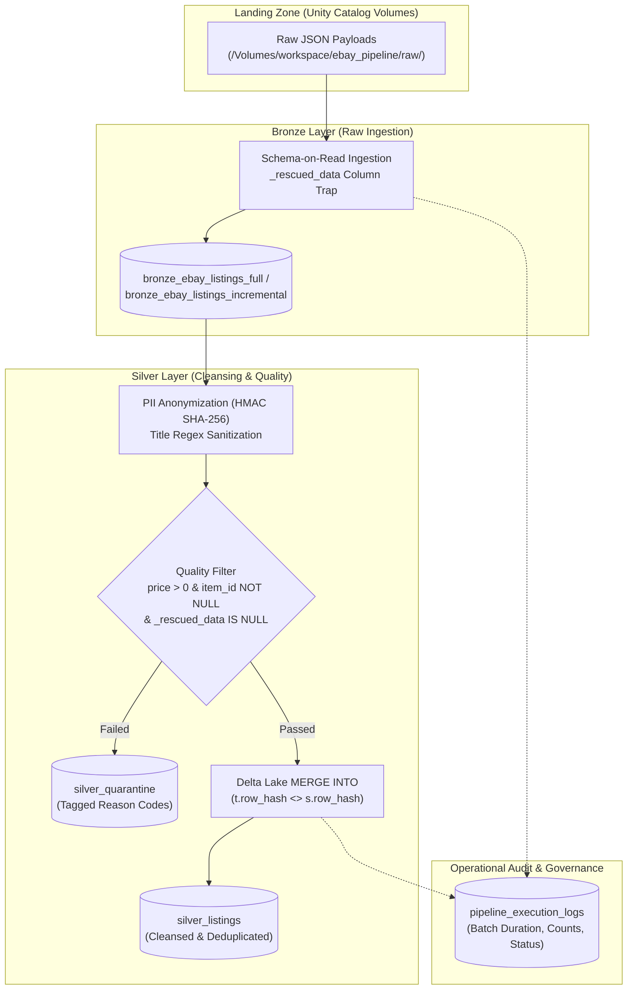

# eBay Retail Data Pipeline (Medallion Lakehouse)


An enterprise-grade batch and incremental data pipeline built on Databricks Lakehouse and Unity Catalog. Ingests raw eBay Browse API listing data, manages schema evolution, hashes PII to ensure GDPR/CCPA compliance, routes invalid records into a quarantine quarantine table, and performs idempotent upserts into Silver Delta tables with full audit logging.

---

## Architecture Overview

This pipeline follows the **Medallion (Bronze → Silver → Gold)** architecture under Databricks Unity Catalog governance:



---

## Key Features & Technical Implementation

### 1. Unified Catalog & Storage Architecture
Governed entirely within **Databricks Unity Catalog** using a standard 3-level namespace:
- **Catalog:** `workspace`
- **Schema:** `ebay_pipeline`
- **Volume:** `raw` (`/Volumes/workspace/ebay_pipeline/raw/`) containing dedicated staging zones:
  - `full_load/` for bulk baseline loads.
  - `incremental_load/` for recurring change data partitions.

### 2. Schema Evolution & Drift Resilience
- Ingests semi-structured JSON payloads via explicit PySpark schemas combined with Databricks' `_rescued_data` column configuration.
- Any unmapped fields, type mismatches, or malformed JSON tokens are automatically captured in `_rescued_data` rather than throwing pipeline runtime errors or corrupting downstream tables.

### 3. PII Anonymization & Cryptographic Security
- **Seller Identity Protection:** Hashes `seller_username` using HMAC SHA-256 with a dynamic salt key fetched at runtime via `get_secret_salt()` (`dbutils.secrets.get(scope="ebay_secrets", key="hmac_key")`).
- **Contact Scrubbing:** Listing titles are scrubbed via regex to redact inadvertent phone numbers and email addresses (`[REDACTED]`).
- Guarantees compliance with privacy standards (GDPR, CCPA) while retaining referential integrity across analytical joins.

### 4. Quality Control & Idempotent Upserts
- **Quarantine Routing:** Non-conforming records are isolated without halting pipeline execution and written into `workspace.ebay_pipeline.silver_quarantine` with granular triage codes:
  - `MISSING_ITEM_ID`: Record lacks mandatory primary identifier.
  - `INVALID_PRICE`: Listing price is `NULL` or `<= 0`.
  - `SCHEMA_DRIFT_DETECTED`: Record contained trapped data in `_rescued_data`.
- **Deduplication:** In-batch deduplication via `row_number()` window partitioning over `item_id` ordered by latest `ingestion_timestamp`.
- **Idempotent MERGE:** Employs Delta Lake `MERGE INTO` with deterministic SHA-256 row hashing (`row_hash = sha2(price + condition + title)`). Re-running the pipeline on identical input results in **0 inserted rows** and **0 updated rows**, eliminating duplicate data risks on retries or backfills.

### 5. Operational Audit Logging & Telemetry
Every pipeline execution step is wrapped in structured observability logging. Operational metrics are recorded to `workspace.ebay_pipeline.pipeline_execution_logs`:
- Batch ID & Execution Step name
- Source and Target table metadata
- Rows inserted, updated, and quarantined
- Batch execution duration (seconds) and job status (`SUCCESS` / `FAILED`)

---

## Repository Structure

```text
├── notebooks/
│   ├── 00_config/
│   │   └── 00_config.ipynb             # Shared parameters, schemas, tables & HMAC secrets
│   ├── 01_ingestion/
│   │   └── 01_ebay_direct_ingestion.ipynb # Raw eBay API extract logic
│   ├── 02_bronze/
│   │   └── 02_bronze.ipynb             # Raw Volume -> Bronze Delta with _rescued_data
│   ├── 03_silver/
│   │   └── 03_silver.ipynb             # PII masking, Quarantine filter & Idempotent MERGE
│   └── 04_gold/                        # Analytical aggregations and business metrics
├── setup_environment/
│   └── 00_setup_environmen.ipynb       # Unity Catalog, Schema, and Volume DDL initialization
├── src/
│   └── utilities/
│       └── logger.ipynb                # Reusable audit logging utility
├── data/
│   └── raw/                            # Sample raw JSON files (full_load & incremental)
└── README.md
```

---

## Execution Guide

### Prerequisites
1. **Databricks Workspace** (Community Edition or Enterprise tier).
2. **Unity Catalog** enabled with permissions to create catalogs, schemas, and volumes.
3. **Databricks Runtime:** 13.3 LTS+ (Apache Spark 3.4+, Python 3.10+).
4. *(Optional)* Databricks Secret Scope named `ebay_secrets` with key `hmac_key` (falls back to widget parameter if unconfigured).

---

### Step-by-Step Setup

#### 1. Clone Repository
In your Databricks Workspace:
1. Navigate to **Workspace > Users > [Your Username]**.
2. Click **Add > Git Folder**.
3. Paste the GitHub repository URL and link your repository branch.

#### 2. Initialize Infrastructure
Open and execute `setup_environment/00_setup_environmen.ipynb` to provision the Unity Catalog namespace:
```sql
CREATE CATALOG IF NOT EXISTS workspace;
CREATE SCHEMA IF NOT EXISTS workspace.ebay_pipeline;
CREATE VOLUME IF NOT EXISTS workspace.ebay_pipeline.raw;
```

#### 3. Upload Raw Source Files
Upload source JSON files into the landing zone volume:
- Full load files: `/Volumes/workspace/ebay_pipeline/raw/full_load/`
- Incremental files: `/Volumes/workspace/ebay_pipeline/raw/incremental_load/`

*(Alternatively, run `notebooks/01_ingestion/01_ebay_direct_ingestion.ipynb` to ingest sample data directly).*

#### 4. Run Bronze Ingestion
Execute `notebooks/02_bronze/02_bronze.ipynb`:
- Ingests raw JSON with `_rescued_data` protection.
- Enriches records with ingestion timestamps and batch metadata.
- Populates `workspace.ebay_pipeline.bronze_ebay_listings_full`.

#### 5. Run Silver Transformation
Execute `notebooks/03_silver/03_silver.ipynb`:
- Hashes `seller_username` using HMAC SHA-256.
- Routes invalid records (`price <= 0`, missing `item_id`, schema anomalies) to `silver_quarantine`.
- Executes Delta Lake `MERGE INTO` targeting `workspace.ebay_pipeline.silver_listings`.

---

## Verification & Audit Checks

### 1. Verify Pipeline Execution Logs
Check execution metrics and duration across pipeline steps:
```sql
SELECT 
    step_name,
    load_type,
    target_table,
    inserted_count,
    updated_count,
    quarantined_count,
    duration_seconds,
    status,
    executed_at
FROM workspace.ebay_pipeline.pipeline_execution_logs
ORDER BY executed_at DESC;
```

### 2. Verify Idempotency (Zero-Duplicate Test)
Re-run `notebooks/03_silver/03_silver.ipynb` with the exact same batch parameters:
```sql
-- Re-run should reflect 0 new inserts and 0 updates
SELECT 
    batch_id,
    inserted_count,
    updated_count,
    status
FROM workspace.ebay_pipeline.pipeline_execution_logs
WHERE step_name = 'Bronze-to-Silver'
ORDER BY executed_at DESC
LIMIT 2;
```
Expected output for the second run:
`inserted_count = 0`, `updated_count = 0`.

### 3. Inspect Quarantined Records
Audit bad or corrupt listings caught by quality rules:
```sql
SELECT 
    reason_code,
    COUNT(*) AS total_failed_records
FROM workspace.ebay_pipeline.silver_quarantine
GROUP BY reason_code;
```

---

## Tech Stack & Core Libraries

- **Storage & Metadata:** Databricks Unity Catalog, Delta Lake
- **Engine:** Apache Spark (PySpark Structured APIs)
- **Security:** HMAC-SHA256, Databricks Secrets API
- **Data Quality:** Delta Lake ACID Transactions, Quarantine Routing, `_rescued_data` Schema Rescue
