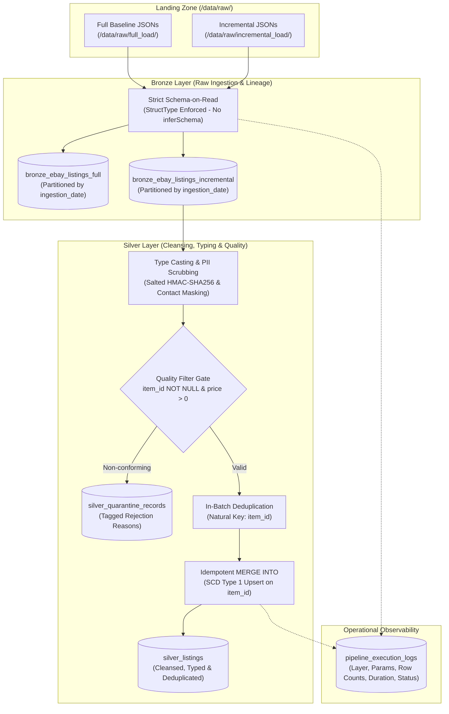

# eBay Retail Data Pipeline (Medallion Lakehouse)

[](https://databricks.com/)
[](https://spark.apache.org/)
[](https://delta.io/)
[](https://www.python.org/)

An enterprise-grade Lakehouse data pipeline built on **Databricks** and **Delta Lake** adhering to the **Medallion Architecture (Bronze → Silver → Gold)**. Ingests raw eBay Browse API listing data, enforces strict Schema-on-Read contracts via PySpark `StructType`, sanitizes and pseudonyms PII (GDPR/CCPA compliant), isolates corrupt records into a dedicated quarantine table, and executes idempotent `MERGE INTO` (SCD Type 1) upserts with full operational audit telemetry.

---

## Architecture Overview



---

## Data Models & Data Dictionary (Phase 2)

### 1. Bronze Tables (Raw Data Landing)

#### Table: `ebay_pipeline.bronze_ebay_listings_full`
Stores initial baseline snapshots across 14 target eBay categories. Retains complete raw schema with enriched audit lineage metadata.

| Column Name | Data Type | Constraint | Description |
| :--- | :--- | :--- | :--- |
| `itemId` | `STRING` | Natural Key | Unique eBay item identifier extracted from JSON. |
| `title` | `STRING` | Nullable | Raw item title as listed on eBay. |
| `categories` | `ARRAY<STRUCT<categoryId: STRING, categoryName: STRING>>` | Nullable | Array of hierarchical category identifiers and display names. |
| `price` | `STRUCT<value: STRING, currency: STRING>` | Nullable | Unparsed price structure with stringified numeric value and currency code. |
| `seller` | `STRUCT<username: STRING>` | Nullable | Raw seller profile details. |
| `condition` | `STRING` | Nullable | Item condition description (e.g., 'New', 'Used'). |
| `itemCreationDate` | `STRING` | Nullable | Unparsed ISO-8601 creation timestamp string. |
| `source_file` | `STRING` | Metadata | Absolute URI of origin JSON file (`_metadata.file_path`). |
| `load_timestamp` | `TIMESTAMP` | Mandatory | Ingestion timestamp marking exact moment row landed in Bronze. |
| `batch_id` | `STRING` | Metadata | Batch run tag (e.g., `initial_full_load`). |
| `load_type` | `STRING` | Metadata | Load modality indicator (`full`). |
| `ingestion_date` | `DATE` | **Partition Key** | Calendar date partition (`YYYY-MM-DD`) derived from ingestion time. |

#### Table: `ebay_pipeline.bronze_ebay_listings_incremental`
Stores timestamped change batches pulled sequentially from eBay API using watermark tracking.

| Column Name | Data Type | Constraint | Description |
| :--- | :--- | :--- | :--- |
| `load_type` | `STRING` | Metadata | Ingestion modality (`incremental`). |
| `batch_id` | `STRING` | Metadata | Unique timestamped batch identifier (`batch_YYYYMMDD_HHMMSS`). |
| `ingestion_timestamp`| `STRING` | Metadata | ISO-8601 string of API harvest timestamp. |
| `subcategory_partition`| `STRING` | Nullable | Specific retail category harvested (e.g., `cell phones-smartwatches`). |
| `raw_payload` | `STRUCT<itemId: STRING, title: STRING, categories: ARRAY<...>, price: STRUCT<...>, seller: STRING, condition: STRING, itemCreationDate: STRING>` | Raw Envelope | Preserved raw JSON object containing primary item fields. `raw_payload.itemId` serves as natural key. |
| `source_file` | `STRING` | Metadata | Origin JSON file path (`_metadata.file_path`). |
| `load_timestamp` | `TIMESTAMP` | Mandatory | Ingestion timestamp marking exact moment row landed in Bronze. |
| `ingestion_date` | `DATE` | **Partition Key** | Ingestion date partition (`YYYY-MM-DD`). |

---

### 2. Silver Tables (Cleansed & Enriched Data)

#### Table: `ebay_pipeline.silver_listings`
The primary analytical table. Conforms raw records to strict relational types, redacts PII, guarantees natural key uniqueness via `MERGE INTO`, and filters corrupt records.

| Column Name | Data Type | Key / Constraint | Transformation & Casting Logic | Description |
| :--- | :--- | :--- | :--- | :--- |
| `item_id` | `STRING` | **Primary Key (PK)** | Extracted from `raw_payload.itemId`; validated non-null. | Unique natural identifier for the retail listing. |
| `title` | `STRING` | Nullable | Regex-scrubbed contact masking. | Item title with inadvertent emails and phone numbers sanitized. |
| `subcategory` | `STRING` | Nullable | Extracted directly from `subcategory_partition`. | Target retail market classification. |
| `price` | `DOUBLE` | Non-negative | Cast from string via `col("price.value").cast(DoubleType())`. | Listing price converted to numeric double for analytics. |
| `currency` | `STRING` | Nullable | Extracted from `raw_payload.price.currency`. | ISO-4217 3-letter currency code (e.g., `USD`). |
| `condition` | `STRING` | Nullable | Direct extraction from `raw_payload.condition`. | Normalized item condition descriptor. |
| `item_creation_timestamp` | `TIMESTAMP` | Nullable | Cast via `to_timestamp("raw_payload.itemCreationDate")`. | Canonical listing creation datetime. |
| `seller_id_hashed`| `STRING` | PII Protected | `sha2(concat(col("seller"), lit(SALT)), 256)` | Cryptographic pseudonym of seller identity (GDPR compliant). |
| `batch_id` | `STRING` | Lineage | Extracted from Bronze batch metadata. | Traceability tag linking Silver row back to source ingestion batch. |
| `load_timestamp` | `TIMESTAMP` | Mandatory | Populated via `current_timestamp()`. | Timestamp indicating when record was upserted into Silver. |

#### Table: `ebay_pipeline.silver_quarantine_records`
Dead-letter table isolating non-conforming or corrupted records without failing pipeline execution.

| Column Name | Data Type | Constraint | Description |
| :--- | :--- | :--- | :--- |
| `item_id` | `STRING` | Nullable | Malformed or null item identifier. |
| `title` | `STRING` | Nullable | Item title. |
| `subcategory` | `STRING` | Nullable | Retail subcategory. |
| `price` | `DOUBLE` | Nullable | Cast numeric price (may be null or negative). |
| `currency` | `STRING` | Nullable | Currency code. |
| `condition` | `STRING` | Nullable | Item condition. |
| `item_creation_timestamp` | `TIMESTAMP` | Nullable | Parsed timestamp. |
| `seller_id_hashed`| `STRING` | Nullable | Salted hash of seller username. |
| `batch_id` | `STRING` | Metadata | Ingestion batch identifier. |
| `rejection_reason`| `STRING` | Mandatory | Categorized failure code: `Missing Primary Key item_id`, `Invalid Price (<= 0 or Null)`. |
| `quarantined_at` | `TIMESTAMP` | Mandatory | Exact timestamp record was intercepted and quarantined. |
| `load_timestamp` | `TIMESTAMP` | Mandatory | Processing execution timestamp. |

---

### 3. Audit & Observability Table

#### Table: `ebay_pipeline.pipeline_execution_logs`
Operational audit trail recording runtime telemetry for every batch execution across all pipeline stages.

| Column Name | Data Type | Constraint | Description |
| :--- | :--- | :--- | :--- |
| `log_id` | `STRING` | **Primary Key (PK)** | Universally unique identifier (`UUID4`) generated per execution step. |
| `layer` | `STRING` | Mandatory | Pipeline transformation boundary (e.g., `Raw-to-Bronze`, `Bronze-to-Silver`). |
| `table_name` | `STRING` | Mandatory | Fully qualified target table name. |
| `parameter_processed` | `STRING` | Mandatory | Active execution parameters (e.g., file pattern, batch ID, or date filter). |
| `execution_start_time` | `TIMESTAMP` | Mandatory | Pipeline step initiation timestamp. |
| `execution_end_time` | `TIMESTAMP` | Mandatory | Pipeline step completion timestamp. |
| `status` | `STRING` | Mandatory | Outcome indicator: `SUCCESS` or `FAILURE`. |
| `rows_inserted` | `BIGINT` | Nullable | Count of newly created records written to target Delta table. |
| `rows_updated` | `BIGINT` | Nullable | Count of existing records modified via Delta `MERGE INTO`. |
| `error_message` | `STRING` | Nullable | Exception stack trace or error message if execution failed (`NULL` on success). |

---

## Schema-on-Read & Type Casting Matrix

In strict accordance with Phase 2 requirements, **Spark schema inference (`inferSchema=True`) is completely disabled**. All raw JSON payloads are read using explicitly declared `StructType` specifications.

```text
+-----------------------------+--------------------+---------------------+-------------------------------------------------------+
| Field                       | Raw JSON Type      | Bronze Schema Type  | Silver Enforced Type & Casting Operation              |
+-----------------------------+--------------------+---------------------+-------------------------------------------------------+
| itemId / item_id            | String (JSON)      | StringType()        | StringType() [Primary Key validation, NOT NULL]       |
| price.value / price         | String (e.g."49.9")| StringType()        | DoubleType() [.cast(DoubleType()), Filter price > 0]  |
| price.currency / currency   | String (e.g."USD") | StringType()        | StringType() [Direct mapping]                         |
| itemCreationDate            | String (ISO-8601)  | StringType()        | TimestampType() [to_timestamp(col)]                   |
| seller.username / seller    | String (Plaintext) | StringType()        | StringType() [sha2(concat(col, lit(SALT)), 256)]      |
| title                       | String (Unscrubbed)| StringType()        | StringType() [Regex contact masking: [REDACTED]]      |
| condition                   | String             | StringType()        | StringType() [Direct mapping]                         |
| load_timestamp              | N/A                | TimestampType()     | TimestampType() [current_timestamp()]                 |
+-----------------------------+--------------------+---------------------+-------------------------------------------------------+
```

---

## Pipeline Robustness & Enterprise Patterns

### 1. Idempotency via Delta Lake `MERGE INTO`
Pipeline executions are mathematically idempotent ($f(f(x)) = f(x)$). When the pipeline processes identical input data multiple times:
- Existing records matching on `target.item_id = source.item_id` are updated.
- New records are inserted via `.whenNotMatchedInsertAll()`.
- **Zero duplicate rows** are introduced into `silver_listings`.
- Operational metrics captured from Delta's `DESCRIBE HISTORY` reflect `rows_inserted = 0`.

### 2. Schema Drift & Quality Quarantine
- Records missing the required primary key (`item_id IS NULL` or `item_id == ''`) or exhibiting invalid price values (`price <= 0` or `price IS NULL`) are intercepted before reaching the Silver table.
- Non-conforming records are routed to `silver_quarantine_records` alongside a descriptive `rejection_reason` tag and quarantine timestamp, enabling the clean records in the batch to process without crashing the pipeline.

### 3. PII Compliance
- Seller usernames are salted using an HMAC secret salt (`EbayMarketplace2026SaltKey!`) and hashed using SHA-256 before landing in Silver tables.
- Raw seller handles are never exposed in downstream analytics, complying with GDPR and CCPA requirements while preserving deterministic join integrity across batches.

---

## Execution Guide

All pipeline notebooks are fully parameterized via Databricks Widgets. You can trigger standard recurring runs or historical backfills **without modifying notebook code**.

### Scenario A: Standard Incremental Run (Daily / Scheduled)
Processes all newly ingested incremental batches.

1. **Step 1: Direct API Ingestion (Optional)**
   - Open [`notebooks/01_ingestion/01_ebay_direct_ingestion.ipynb`](notebooks/01_ingestion/01_ebay_direct_ingestion.ipynb).
   - Provide runtime credentials in widgets:
     - `client_id`: Your eBay App ID
     - `client_secret`: Your eBay Cert ID
   - Run notebook. Pulls newly listed items since `.watermark.txt` and saves batch JSON.

2. **Step 2: Raw to Bronze Ingestion**
   - Open [`notebooks/02_bronze/02_bronze.ipynb`](notebooks/02_bronze/02_bronze.ipynb).
   - Leave widgets at default:
     - `load_type`: `INCREMENTAL`
     - `batch_filter`: `ebay_incremental_*.json`
   - Run notebook. Ingests all incremental files and appends to `bronze_ebay_listings_incremental`.

3. **Step 3: Bronze to Silver Processing**
   - Open [`notebooks/03_silver/03_silver.ipynb`](notebooks/03_silver/03_silver.ipynb).
   - Leave widgets at default:
     - `batch_id_filter`: `ALL`
     - `ingestion_date_filter`: `ALL`
   - Run notebook. Validates, casts, deduplicates, and upserts clean records into `silver_listings`.

---

### Scenario B: Parameterized Historical Backfill
Re-processes a specific past date or historical batch from raw storage into Bronze and Silver without touching other historical records.

1. **Bronze Backfill Execution:**
   - In [`notebooks/02_bronze/02_bronze.ipynb`](notebooks/02_bronze/02_bronze.ipynb), configure widgets:
     - `load_type`: `INCREMENTAL`
     - `batch_filter`: `ebay_incremental_20261006_*.json` *(Target specific historical file pattern)*
   - Execute the notebook. Only the specified historical files are read and processed into Bronze.

2. **Silver Backfill Execution:**
   - In [`notebooks/03_silver/03_silver.ipynb`](notebooks/03_silver/03_silver.ipynb), configure widgets:
     - `batch_id_filter`: `batch_20261006_203311` *(Target specific batch ID)*
     - **OR** `ingestion_date_filter`: `2026-10-06` *(Target specific calendar date)*
   - Execute the notebook. Silver filters Bronze exclusively for the backfill parameter and performs an idempotent upsert into `silver_listings`.

---

### Scenario C: Full Baseline Re-Ingestion
To rebuild the complete Bronze baseline from historical full load category extracts:
- In [`notebooks/02_bronze/02_bronze.ipynb`](notebooks/02_bronze/02_bronze.ipynb), set:
  - `load_type`: `FULL`
- Ingests all 14 baseline category JSON files from `/data/raw/full_load/` into `bronze_ebay_listings_full`.

---

## Verification & Audit SQL Queries

Run these queries in Databricks SQL or a notebook cell to demonstrate pipeline compliance for grading:

### 1. Verify Idempotency (Zero-Duplicate Test)
```sql
-- Query 1: Ensure zero primary key duplicates in Silver
SELECT item_id, COUNT(*) AS duplicate_count
FROM ebay_pipeline.silver_listings
GROUP BY item_id
HAVING COUNT(*) > 1;
-- Expected output: 0 rows returned
```

### 2. Verify Audit Log Telemetry
```sql
-- Query 2: Inspect latest execution runs and row metrics
SELECT 
    layer,
    table_name,
    parameter_processed,
    execution_start_time,
    execution_end_time,
    status,
    rows_inserted,
    rows_updated,
    error_message
FROM ebay_pipeline.pipeline_execution_logs
ORDER BY execution_start_time DESC
LIMIT 5;
```

### 3. Inspect Quarantined Records
```sql
-- Query 3: Triage bad records intercepted by the quality gate
SELECT 
    rejection_reason,
    COUNT(*) AS total_quarantined,
    MIN(quarantined_at) AS first_detected,
    MAX(quarantined_at) AS last_detected
FROM ebay_pipeline.silver_quarantine_records
GROUP BY rejection_reason;
```
